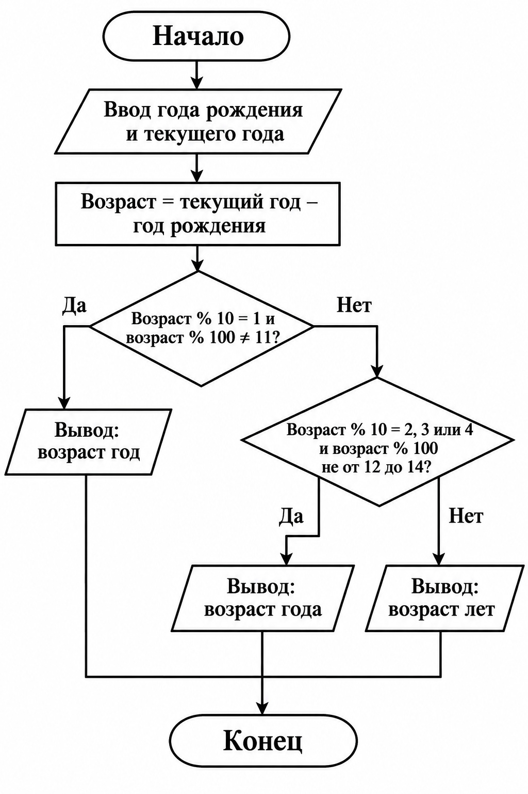

# Домашка к 6 лабе
### Вариант 4
Цель работы — разработать программу на языке C, которая позволяет определить полный возраст человека на основе введённого года рождения и текущего года, а также вывести полученный результат в текстовой форме с правильным склонением слова «год».

Вывод: В ходе выполнения задания была разработана программа на языке C, которая вычисляет возраст человека по году рождения и текущему году. Были использованы условные операторы для определения правильной формы слова «год». В результате были закреплены навыки работы с переменными, арифметическими операциями и условными конструкциями языка C.
